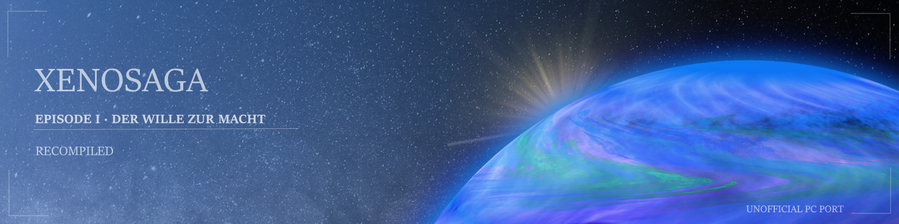

# Xenosaga Episode I: Recompiled

  

  
  
  

An unofficial native PC port of **Xenosaga Episode I: Der Wille zur Macht**, built using [PS2Recomp](https://github.com/ran-j/PS2Recomp).

Originally developed by [BeyondNeteros](https://github.com/BeyondNeteros/xenosaga-recomp-FREE-TO-USE), this fork continues development of the port.

The goal is to make Xenosaga Episode I playable on modern PCs with good performance, improved graphics, and support for modern hardware.

> **Work in progress.** The game is playable in tested early-game areas, but a complete playthrough has not yet been validated.

## Screenshots

<table>
  <tr>
    <td align="center"> Exploration</td>
    <td align="center"> Combat</td>
  </tr>
  <tr>
    <td align="center"> In-engine cinematic</td>
    <td align="center"> Game interface</td>
  </tr>
</table>

*Screenshots from a development build of the native PC port.*

## Current Status

| Component | Status |
|---|---|
| Game recompilation | Working |
| Boot and disc access | Working |
| Menus and cinematics | Working |
| Exploration and battles | Tested in early-game areas |
| Audio | Working, with synchronization issues |
| Keyboard and controller | Supported |
| GPU rendering (OpenGL) | Supported |
| Vulkan rendering (paraLLEl-GS) | Experimental; preferred on the validated Windows/NVIDIA system |
| Resolution scaling | Supported |
| Widescreen | Experimental |
| Full-game compatibility | Untested |

## Features

- Native Windows x64 execution
- GPU-accelerated OpenGL rendering
- Experimental Vulkan renderer based on [paraLLEl-GS](https://github.com/Arntzen-Software/parallel-gs), with native resolution (X1), genuine 2x per-axis internal rasterization (X4), and additional X8/X16 sampling modes
- Adjustable internal resolution
- Fullscreen and experimental widescreen support
- Keyboard and controller input
- Battle fast-forward and optional gameplay settings
- Built-in FPS counter and screenshot capture

## Getting Started

### Requirements

- Xenosaga Episode I (USA, `SLUS-20469`) in ISO format
- Windows 10 or 11 (64-bit)
- AVX2-capable processor
- Approximately 10 GB of available storage
- OpenGL 4.5 with fragment shader interlock for the OpenGL renderer
- For the optional Vulkan renderer: a GPU and driver supporting the Vulkan features required by paraLLEl-GS (validated only on an NVIDIA GeForce RTX 4090). See the [Vulkan renderer guide](docs/VULKAN.md).

A CPU renderer is available for systems without compatible graphics hardware.

### Vulkan renderer (experimental)

The Vulkan renderer is the preferred backend on the validated system: Windows 11, Intel Core i9-13900K,
NVIDIA GeForce RTX 4090. The recommended setting there is 2x internal resolution with 16x super-sampling.
Compared with OpenGL in the tested scenes, it avoids the vertical shadow streaking. It is still experimental:

- It is built only when the paraLLEl-GS sources are supplied (see the
  [WSL2 build guide](docs/BUILD_WSL.md#optional-vulkan-renderer)). The launcher build does not include it yet.
- Other GPUs, including AMD and Intel, and other drivers are untested.
- Frame rates still drop below 30 FPS in demanding areas and in-engine cutscenes.
  Sustained 30 FPS gameplay remains an outstanding development goal.
- If Vulkan cannot start, the game exits with a message by default instead of switching renderers.

Select it with `renderer = vulkan` in `settings.ini`. See the [Vulkan renderer guide](docs/VULKAN.md) for
the settings and diagnostics.

### Installation

1. Download the repository.
2. Open `Xenosaga Launcher.bat`.
3. Select your disc image.
4. Install the build tools.
5. Select **Build the game**.
6. Once the build finishes, select **PLAY**.

The launcher generates and compiles the game code locally. Build times depend on your hardware.

Automatic tuning is skipped when no training recording is available. For better performance, play through some gameplay areas and battles, close the game, then select **Optimize** in the launcher. This compiles native VU1 blocks collected locally during play. Repeat as you explore new areas.

If the standard Windows build tools fail to install, see the alternative [WSL2 build guide](docs/BUILD_WSL.md).

The standard Windows launcher installation has not yet been fully validated on a clean system.

Your original disc image is required to play.

## Controls

| Keyboard | PS2 |
|---|---|
| WASD / Arrow keys | Movement |
| X / Space | Cross |
| C / Esc / Backspace | Circle |
| Z | Square |
| V | Triangle |
| Q / E | L1 / R1 |
| Shift | L2 / R2 |
| Enter | Start |
| Tab | Select |

| Shortcut | Function |
|---|---|
| F3 | FPS counter |
| F4 | Scaling filter |
| F5 | Aspect ratio |
| F11 / Alt+Enter | Fullscreen |
| F12 | Screenshot |

Controllers are also supported.

Graphics, audio, and gameplay options can be configured through `settings.ini` next to the game executable.

## Known Issues

- Low frame rates in demanding areas and cutscenes, for example around the central terminals on the Woglinde.
- Audio desynchronization during in-engine cutscenes.
- Occasional texture, shadow, and geometry artifacts. The OpenGL renderer shows vertical shadow streaking.
  The Vulkan renderer did not show it in the tested scenes.
- The Vulkan renderer is validated only on one Windows/NVIDIA system.
- Residual vertical shaking at higher internal resolutions ([#21](https://github.com/gwencrow/xenosaga-recomp/issues/21)).
- Flickering and bottom-edge artifacts in pre-rendered cutscenes ([#20](https://github.com/gwencrow/xenosaga-recomp/issues/20)).
- Corrupted save thumbnails ([#22](https://github.com/gwencrow/xenosaga-recomp/issues/22)).
- Stretched HUD and menus in widescreen mode.
- Limited hardware compatibility testing.

## Roadmap

### Core Development

- [ ] Stable 30 FPS gameplay
- [ ] Further native VU1 optimization ([#6](https://github.com/gwencrow/xenosaga-recomp/issues/6))
- [ ] GS rendering optimization ([#7](https://github.com/gwencrow/xenosaga-recomp/issues/7))
- [x] Evaluate an optional Vulkan graphics backend using paraLLEl-GS ([#23](https://github.com/gwencrow/xenosaga-recomp/issues/23))
- [ ] Integrate the Vulkan renderer into the Windows launcher ([#42](https://github.com/gwencrow/xenosaga-recomp/issues/42))
- [ ] Graphics accuracy improvements
- [ ] Audio synchronization fixes ([#5](https://github.com/gwencrow/xenosaga-recomp/issues/5))
- [ ] Full-game compatibility testing ([#16](https://github.com/gwencrow/xenosaga-recomp/issues/16))

### Planned Enhancements

- [ ] Native widescreen support with corrected HUD and menu scaling ([#14](https://github.com/gwencrow/xenosaga-recomp/issues/14))
- [ ] 60 FPS and higher frame rate support ([#44](https://github.com/gwencrow/xenosaga-recomp/issues/44))
- [ ] Japanese and English voice selection ([#45](https://github.com/gwencrow/xenosaga-recomp/issues/45))
- [ ] Improved launcher with configurable enhancements and graphics presets ([#46](https://github.com/gwencrow/xenosaga-recomp/issues/46))

### Installation and Compatibility

- [ ] Improved installation process ([#8](https://github.com/gwencrow/xenosaga-recomp/issues/8))
- [ ] Broader GPU and driver compatibility testing ([#43](https://github.com/gwencrow/xenosaga-recomp/issues/43))

## Development

The port uses static recompilation to translate the original PS2 executable and its five code overlays into native host code.

It currently targets PS2Recomp commit `e563698` with the modifications in `patches/ps2recomp-runtime.patch`.
The optional Vulkan renderer uses paraLLEl-GS commit `cc6184a` with `patches/parallel-gs.patch`.

The [Xenosaga Episode I decompilation project](https://github.com/OpokXeno/xsg-i-decomp) serves as a technical reference for understanding the original game's architecture, function symbols, rendering pipeline, audio systems, and game-specific behavior. Its use as a reference has been [authorized by the project owner](https://github.com/OpokXeno/xsg-i-decomp/issues/74#issuecomment-7188213847), with attribution.

The recompilation and decompilation projects are independent. Recovered game source code is not incorporated into or distributed with this repository.

| Directory | Contents |
|---|---|
| `src/` | Game-specific hooks and overrides |
| `tools/` | Build and diagnostic utilities |
| `patches/` | PS2Recomp runtime and paraLLEl-GS modifications |
| `launcher/` | Windows launcher |
| `dist/` | Runtime launch script |
| `tests/` | Unit tests and host-side regression tests |
| `cmake/` | CMake toolchain configuration for Windows cross-compilation |
| `docs/` | Development documentation and project images |

### Developer Documentation

- [Development Guide](docs/DEVELOPMENT.md)
- [WSL2 Build Guide](docs/BUILD_WSL.md)
- [Vulkan Renderer](docs/VULKAN.md)
- [VU1 Performance and Validation](docs/VU1_PERFORMANCE.md)
- [Changelog](CHANGELOG.md)

## Contributing

Contributions and bug reports are welcome.

- [Contribution Guide](CONTRIBUTING.md)
- [Development Issues](https://github.com/gwencrow/xenosaga-recomp/issues)
- [Code of Conduct](CODE_OF_CONDUCT.md)

When reporting an issue, please include your hardware specifications, operating system, graphics settings, build version, and steps to reproduce it.

Do not upload game files, generated game code, memory dumps, or other proprietary game data.

## Credits

- [BeyondNeteros](https://github.com/BeyondNeteros): Original port development
- [OpokXeno and contributors](https://github.com/OpokXeno/xsg-i-decomp): Xenosaga Episode I decompilation, technical documentation, and reverse-engineering research.
- [PS2Recomp](https://github.com/ran-j/PS2Recomp): Recompilation framework
- [paraLLEl-GS](https://github.com/Arntzen-Software/parallel-gs) and [Granite](https://github.com/Themaister/Granite): Vulkan GS renderer (optional)
- [FFmpeg](https://ffmpeg.org/): Multimedia decoding

## Image Credits

- Gameplay screenshots show Xenosaga Episode I and are included to document the port. The underlying game imagery belongs to its respective rights holders.
- The banner incorporates [Blue gas giant](https://commons.wikimedia.org/wiki/File:Blue_gas_giant.png) by [unnamed](https://opengameart.org/users/unnamed), originally published in the [16 Planet Sprites](https://opengameart.org/content/16-planet-sprites) collection on OpenGameArt. The planet artwork is dedicated to the public domain under [CC0 1.0 Universal](https://creativecommons.org/publicdomain/zero/1.0/) and has been adapted for the project banner.

Third-party imagery retains its respective copyright and licensing status and is not relicensed under the software GPLv3 license.

## License

Copyright (C) 2026 BeyondNeteros and contributors.

The code in this repository (the port code, launcher, tools and the
PS2Recomp runtime patch) is free software: you can redistribute it and/or
modify it under the terms of the **GNU General Public License, version 3**
(see [`LICENSE`](LICENSE)), the same license as
[PS2Recomp](https://github.com/ran-j/PS2Recomp), which this port builds on and
patches. Parts of the movie decoder's MPEG tables come from FFmpeg
(LGPL 2.1 or later), credited in that file. `patches/parallel-gs.patch`
modifies paraLLEl-GS and is provided under paraLLEl-GS's license
(LGPL 3.0 or later). paraLLEl-GS, Granite (MIT), volk (MIT) and
Vulkan-Headers (Apache 2.0 / MIT) are fetched separately and keep their own
licenses. See the [Vulkan renderer guide](docs/VULKAN.md#licenses).

The license covers this project's own code only:

- **Xenosaga Episode I is not included and not licensed here.** The game, its
  code, data, movies and audio, and anything generated from them (such as the
  recompiled C++ the launcher builds on your PC), belong to their owners
  (Bandai Namco / Monolith Soft). You need your own copy of the game. Don't
  share game files or builds that contain them.
- The game decompilation used as a reference during development is not part
  of this repository and is not covered by this license.

This is an unofficial fan project and is not affiliated with Bandai Namco
or Monolith Soft.
